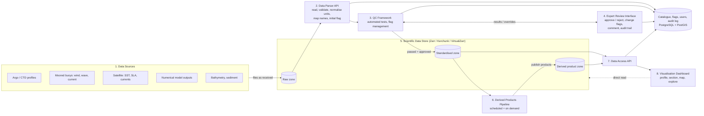

# SCATS POC: Architecture (Phase 1)

Ocean Environment and Acoustic Intelligence System for Geo-spatial Analysis and
Target-Based Modelling. Proof of concept for GeM bid GEM/2026/B/8266583.

Status: DRAFT for review. Built from the Scope of Work supplied with the bid.

## 1. Component diagram and data flow

Reading the diagram:

1. Source files land untouched in the **raw zone**.
2. The **parser** converts each source into the common data model and assigns an initial flag.
3. The **QC framework** runs automated tests and stores a flag for every observation and variable, naming the test that set it.
4. The **review interface** lets a scientist inspect the results, override flags and approve or reject a dataset. Every action is written to the audit log, and the loop with QC is two-way.
5. Approved data moves to the **standardised zone**, which is the source of truth.
6. The **products pipeline** reads the standardised zone and writes products to the **derived zone**.
7. The **Data Access API** serves observations, metadata and products to people and other systems.
8. The **dashboard** is the user-facing layer on top of the API and the store.

## 2. Technology choices

| Concern | Choice | Reason |
|---|---|---|
| Language | Python 3.12 | Standard for ocean science; xarray, gsw and netCDF libraries are mature. |
| API framework | FastAPI | Automatic OpenAPI docs, which the scope asks for in programmatic access. |
| Array data | xarray | Labelled N-dimensional data maps directly onto CF/NetCDF models. |
| Storage format | Zarr | Cloud-native chunked arrays named in the scope of work. |
| Reference files | Kerchunk, VirtualiZarr | Read existing NetCDF/HDF files as Zarr without copying them. Named in the scope. |
| Seawater physics | gsw (TEOS-10) | Accepted standard for density, sound speed and heat content. |
| Object storage | SeaweedFS with S3 gateway | Open source, runs on a laptop or on-premise. MinIO was dropped because its free community images are no longer published. All code uses only the S3 API, so the store can be swapped by editing one compose service. |
| Catalogue and audit | PostgreSQL 16 + PostGIS | Spatial queries on observations, relational integrity, trigger-enforced append-only audit log. |
| Packaging | Docker Compose | One command to start, and runs on laptop, cloud or on-premise as the scope requires. |
| Standards | CF Conventions, GOOS recommendations, OGC | Required by the scope of work (see `data_model.md`). |
| Frontend (Phase 5) | React, MapLibre, Plotly or ECharts | Open-source, no licence cost, handles maps and profile plots. |

## 3. Scope: what is in the POC

| Area | In POC | Future-ready only |
|---|---|---|
| Ingestion of 3 formats (NetCDF, CSV, raw-style) | Yes (Phase 2) | More instrument formats |
| Automated QC and flag history | Yes (Phase 2) | Instrument-specific tests for NPOL sensors |
| Expert review with audit trail | Yes (Phase 3) | Multi-step approval workflows |
| Three-zone Zarr store | Yes (Phase 3) | Tiered or archival storage |
| Derived products (T-S, sections, MLD, OHC, sound speed, climatologies) | Yes (Phase 4) | Full acoustic propagation modelling |
| Data Access API | Yes (Phase 4) | OGC web services (WMS/WCS/SensorThings) |
| Dashboard (profile, section, map, explore) | Yes (Phase 5) | Collaborative features |
| Machine learning, forecasting, advanced analytics | No | Extension points only |
| Secure sharing with external stakeholders | Roles only | Federated login, fine-grained sharing |

"Future-ready" means the design leaves room (for example, the derived zone and the products pipeline can host a model output) but nothing is built.

## 4. Storage zones

| Zone | Bucket | Contents | Rule |
|---|---|---|---|
| Raw | `raw` | Original files exactly as received | Never modified. Versioning on. Checksums in `MANIFEST.sha256`. |
| Standardised | `standardised` | Common-model datasets that passed QC and review | Written only after approval. Source of truth. |
| Derived | `derived` | Products generated from the standardised zone | Reproducible from the standardised zone. |

## 5. Open design decision for Phase 2/3: where flags live

QC flags are needed in two places, and Phase 1 does not yet say how they stay consistent:

* **Zarr** holds the full per-level flag arrays next to the data (needed to build products fast).
* **PostgreSQL** (`qc_flag`) holds a queryable record of decisions, including who/what set each one.

Storing a row per good value in PostgreSQL would not scale to large archives. Proposal: Zarr is the source of truth for the flag *values*; PostgreSQL stores every flag that is **not 1 (good)**, every human override, and a per-observation summary (`overall_flag`). A reconcile job compares the two. To be confirmed when Phase 2 writes its first flags.

## 6. What Phase 1 delivers from this design

Compose stack (database, object storage, API skeleton), the database schema with a limited API role, the three buckets, the data model specification, sample data and an error-injected test set. Components 2 to 8 exist as empty folders with a README stating what comes in which phase.
